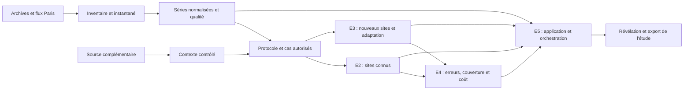

# ParisPulse - Plan de réalisation

Version du **10 novembre 2026**, fondée sur la lecture intégrale de [ParisPulse_Sujet_etudiants.pdf](ParisPulse_Sujet_etudiants.pdf), y compris les tableaux, fiches des cinq équipes, livrables et barèmes. Le nouveau sujet précise le PDF initial et gouverne cette révision. Les choix de stack, de modèles et de dates ci-dessous sont des propositions ; ils ne sont pas imposés par le sujet.

## 1. Objectif et changements à intégrer

La [structure de travail](doc/ARCHITECTURE.md) et les [consignes E2](src/models/known/README.md) détaillent les fichiers à compléter et les échanges entre équipes.

Livrer un outil pour un chargé d'études de mobilité : explorer le réseau parisien, comprendre les séries disponibles, prévoir **24 valeurs horaires**, rejouer une date passée, révéler les observations et identifier les limites des résultats. L'application doit traiter les sites déjà observés et l'arrivée d'un site disposant de peu de mesures.

| Point | Exigence du nouveau sujet | Conséquence sur le plan |
| --- | --- | --- |
| Calendrier | Trois journées complètes + une demi-journée d'évaluation | Première intégration dès la matinée de J1 ; restitution séparée |
| Effectifs | Cinq équipes de 3 à 4, soit 15 à 20 étudiants | Responsabilités techniques et contributions individuelles identifiables |
| Équipes 2 et 3 | Prévision sur sites connus / prévision sur nouveaux sites | Deux méthodes ou modes exécutables, deux évaluations et deux parcours dans l'application |
| Deep learning | Au moins une expérience collective obligatoire | Travail prévu dès J1, avec une solution compacte de repli |
| Contexte | Source complémentaire à intégrer et à étudier | Calendrier officiel proposé en première option ; ablation mesurée |
| Échantillon | Étudier le réseau avant la sélection scientifique | Inventaire et critères justifiés ; premier cas technique seulement provisoire |
| Extension | Traiter le plus grand ensemble raisonnable dans le budget | Périmètre croissant, couverture et coût mesurés ; pas de quota arbitraire |
| Méthodes | Choix appuyé sur une recherche bibliographique | Lectures, hypothèses et comparaisons consignées avant les résultats |
| Protocole | Validation par le professeur avant la sélection des modèles | Proposition explicite et état de validation conservé |
| Mesure | MAE par compteur puis moyenne entre compteurs | Indicateur principal commun, séparé entre les deux situations |
| Couverture | Cas complets de 24 heures, échecs et causes | Comparaisons sur les mêmes cas complets, avec évaluation des replis |
| Produit | Export, provenance, couverture et coût | Fonctions dédiées ; distinction carte/inventaire/prévisions réellement possibles |
| Reproduction | Une commande prépare et lance ; un tiers recalcule un autre cas | La référence reste calculable à la demande ; les caches seuls ne suffisent pas |
| Remise | Rapport par équipe, présentations, journal individuel | Modèles de suivi et checklist dans [SUIVI_ET_REMISE.md](doc/SUIVI_ET_REMISE.md) |

Les obligations de deep learning, de nouveaux sites et de contexte deviennent centrales. Les anciennes propositions qui les traitaient comme extensions sont remplacées par le présent plan.

## 2. Périmètre, priorités et définition de « terminé »

### P0 - nécessaire pour répondre au sujet

- Inventorier années, identifiants, sites, sens, installations, volumes, historique, manques, longues suites de zéros et répartition géographique.
- Choisir une période et un échantillon diversifiés sur des informations autorisées avant le test ; documenter exclusions et cas difficiles.
- Préparer une chaîne réelle dès J1 matin, puis élargir le périmètre après l'inventaire.
- Fournir une référence simple recalculable et son repli ; comparer au moins une autre approche justifiée.
- Réaliser et analyser **au moins une expérience de deep learning**, même si le modèle n'est pas finalement retenu.
- Sur sites nouveaux, comparer la même méthode sans/avec adaptation, sur les mêmes observations locales autorisées, ainsi qu'une référence équitable.
- Intégrer une source externe et mesurer son intérêt, avec une jointure contrôlée et une ablation.
- Respecter un protocole temporel et spatial discuté avec les équipes et validé par le professeur avant sélection.
- Afficher les deux situations, l'historique, les 24 prévisions, la révélation, les erreurs, le contexte, les échecs et les replis.
- Exporter prévisions, scores, provenance et périmètre ; mesurer erreur, couverture et temps de calcul.
- Installer et lancer en une commande après les prérequis ; tester une copie neuve, un redémarrage et un autre cas admissible.
- Livrer rapports et présentations par équipe, démonstration collective et journaux individuels.

Une conclusion négative sur l'adaptation, le contexte ou le deep learning est acceptable si l'expérience est valide, reproductible et interprétée. Une tentative de chargement qui échoue n'est pas, à elle seule, une expérience scientifique suffisante : exécuter la solution compacte de repli sur un périmètre réduit.

### P1 - approfondissements à choisir selon les résultats

Chaque équipe garde une question autonome et une expérience avec un partenaire : deux traitements de zéros, ablation ciblée, budgets d'historique local, perturbations, stabilité du classement ou comparaison cache/calcul à la demande. Les intervalles sont une option d'étude de fiabilité ; une expérience de perturbation peut remplir cette fonction sans intervalle.

### P2 - après stabilisation

Modèle de fondation supplémentaire, météo prévisionnelle archivée, réentraînement fréquent, stockage distribué ou hébergement. GPU et Snowflake peuvent élargir l'étude mais ne conditionnent pas les fonctions essentielles.

## 3. Données, inventaire et contexte

### Sources et vérifications du 10 novembre 2026

| Source | Usage | État vérifié |
| --- | --- | --- |
| [Archives Paris 2016–2025](https://opendata.paris.fr/explore/dataset/comptage-velo-historique-donnees-compteurs/information/) | Historique fixe et étude du réseau | Pièces jointes annuelles présentes ; l'API tabulaire à zéro ligne n'indique pas une absence d'archives |
| [Flux courant](https://opendata.paris.fr/explore/dataset/comptage-velo-donnees-compteurs/information/) | Complément récent | 1 035 548 lignes lors de la requête ; de `2025-10-10T00:00:00Z` à `2026-11-09T22:00:00Z` |
| [Métadonnées compteurs](https://opendata.paris.fr/explore/dataset/comptage-velo-compteurs/information/) | Sites, noms, sens à vérifier, carte | 113 fiches ; ce nombre ne prouve pas une couverture exploitable constante |
| [Jours fériés officiels](https://calendrier.api.gouv.fr/) | Source complémentaire proposée | Endpoint métropole 2026 accessible, 11 dates ; données sous Licence Ouverte selon le dépôt officiel, code sous MIT |
| [Observations Météo-France](https://www.data.gouv.fr/datasets/donnees-climatologiques-de-base-horaires) | Analyse après coup ou météo passée admissible | Source mentionnée dans le sujet ; fichiers, stations, unités et modalités d'accès à auditer si cette piste est choisie |

Les nombres du flux ont changé depuis la consultation du 9 novembre : ils décrivent une requête, pas un instantané déjà livré. Dater chaque extraction et conserver les empreintes. Une archive 2026 absente n'empêche pas l'étude de 2026 via le flux courant.

Les sources de comptage déclarent une licence ODbL ; conserver attribution et licence, et vérifier les obligations de redistribution d'une base dérivée. Les comptages mesurent des **passages**, pas des cyclistes uniques ni tous les déplacements de Paris.

### Inventaire et constitution de l'échantillon

1. Lister les fichiers annuels et schémas sans charger simultanément toutes les archives en mémoire ; examiner les conventions avant concaténation.
2. Produire un registre compteur/site/sens et un regroupement de sites physiques fiable. Deux directions du même site restent ensemble pour les séparations spatiales ; les changements d'identifiant et rapprochements incertains sont tracés.
3. Cartographier et décrire volumes, durées, taux de présence, zéros prolongés et qualité sur une période antérieure au test. Un historique apparemment complet peut être inutilisable à cause de longues suites de zéros.
4. Définir des profils, par exemple volumes faibles/moyens/forts, historique court/long et qualité contrastée. Retenir des représentants, des cas difficiles et des sites réservés avec E4.
5. Figer la liste scientifique et ses critères avant l'examen des performances de test. Le premier compteur de raccordement peut être choisi pour des raisons techniques ; il ne justifie pas l'échantillon final.
6. Étendre par lots ; compter sites et compteurs retenus, rejetés et incertains, avec les raisons. Signaler les profils nouveaux par rapport à l'échantillon initial.

La taille dépend de la distribution réelle et du budget de calcul. Un essai technique sur un compteur, puis quelques séries, puis des lots croissants sert à estimer ce budget ; il ne constitue pas un objectif de couverture imposé.

### Nettoyage et provenance

- Distinguer archives **par compteur/heure avec sens** et **par site/quart d'heure sans sens**. Ne pas empiler ces produits. Commencer par le produit horaire.
- Utiliser `id_compteur` comme clé de compteur, et une clé de site distincte. Un nom ou une proximité géographique ne suffit pas à raccorder deux séries.
- Vérifier début/fin d'intervalle et fuseau dans chaque famille de fichiers ; en cas d'ambiguïté ancienne non résolue, restreindre et justifier la période.
- Normaliser en UTC et utiliser `Europe/Paris` pour calendrier et affichage. Tester les changements d'heure.
- Dédupliquer les chevauchements archive/flux avec une priorité explicite. Un conflit n'est ni une somme automatique ni une suppression silencieuse.
- Conserver le brut, les zéros réels, les manques et les alertes séparément. Ne pas attribuer une cause certaine aux suites de zéros.
- Pour une étude de traitement des zéros, comparer deux préparations de l'entraînement en gardant les mêmes observations d'évaluation ; mesurer aussi le changement de couverture.
- Stocker en Parquet partitionné si nécessaire ; conserver manifestes, URL, licence, date d'extraction, schéma et SHA-256.

### Source complémentaire et jointure

Première proposition : jours fériés métropolitains, joints **sur la date locale de l'heure cible**. Ajouter les libellés et un indicateur, puis comparer le même modèle avec/sans cette information, toutes choses égales par ailleurs. Avec les dates proposées, juillet–août 2026 contient deux jours fériés et octobre aucun : documenter ce faible effectif, analyser l'intérêt sur validation et ne pas prétendre mesurer un effet de jour férié sur le test d'octobre. Si la question nécessite davantage de variation, examiner le calendrier scolaire officiel ou une autre période avant validation du protocole.

Pour toute source, vérifier accès, licence, couverture, unités, géographie, fuseaux et cardinalité. Une jointure gauche vers les comptages doit conserver les clés compteur/heure et leur nombre ; expliquer toute multiplication ou perte de lignes. Conserver date de publication lorsqu'elle existe, date de récupération et rôle prédictif ou descriptif.

Une mesure météo future révélée après coup peut expliquer une erreur ; elle n'entre pas dans la prévision. Une prévision météo n'est admissible que si le bulletin publié avant l'origine historique est retrouvé. Une seule station parisienne n'est pas une mesure locale exacte à chaque compteur.

## 4. Architecture et exécution proposées

**Stack proposée :** Python 3.11+, pandas pour les échanges CSV, scikit-learn, PyTorch CPU pour le réseau compact, Streamlit, Folium et Plotly. PyArrow/Parquet ou DuckDB peuvent servir au stockage interne si les volumes le justifient. Les équipes choisissent et figent les dépendances dans requirements.txt ; aucune de ces bibliothèques n’est encore installée par le squelette.



Une application Python commune appelle directement les modules des équipes. E5 ne réécrit ni le nettoyage, ni les modèles, ni les scores. Les contrats v2 précisent les échanges. Préparer des exemples conformes créés par les étudiants, puis les remplacer rapidement par les sorties réelles.

### Organisation cible à implémenter

```text
requirements.txt                # dépendances à choisir et figer
run.sh.example                  # consignes pour le futur lanceur unique
config/project.example.yaml     # paramètres à renseigner et adopter
src/common/                     # E1–E5 : contrats et configuration
src/data/                       # E1 : acquisition, inventaire, qualité, contexte
src/models/known/               # E2 : référence et modèles sites connus
src/models/new/                 # E3 : transfert et adaptation
src/eval/                       # E4 : protocole, scores, backtest et fiabilité
src/app/                        # E5 : service, interface et export
data/history/ + data/processed/ + data/manifests/
data/prediction_results/ + data/evaluation/
artifacts/models/ + artifacts/cache/ + artifacts/exports/
reports/teams/ + reports/individual/ + reports/experiments/
doc/templates/                  # gabarits CSV, provenance et suivi
tests/                          # contrôles à implémenter
```

Les fichiers du squelette contiennent les consignes à réaliser, sans algorithmes ni application exécutables. Le futur environnement essentiel devra fonctionner sur CPU ; une méthode additionnelle peut déclarer d'autres ressources.

### Installation et calcul

E5 complétera `run.sh.example` pour fournir un véritable `run.sh`. Après les prérequis annoncés, ce lanceur devra créer l'environnement, installer les dépendances verrouillées, préparer les ressources vérifiées et lancer l'application. Annoncer les systèmes pris en charge et la nécessité éventuelle d'un premier accès réseau. Aucun chemin personnel, jeton privé obligatoire ou téléchargement implicite de poids non versionnés.

Fournir ou récupérer un instantané vérifié qui contient plusieurs cas admissibles, dont un autre que la démonstration. L'enseignant peut choisir ce second cas et **recalculer réellement la référence**. Un mode limité à des prédictions préenregistrées ne remplit pas cette exigence. Fournir également les paramètres, code et poids nécessaires aux autres calculs annoncés.

Combiner référence à la demande et cache pour les méthodes plus coûteuses. Mesurer temps à froid, temps à chaud, mémoire et taille des résultats avant de choisir. Invalider le cache lorsque données, contexte, protocole, modèle, adaptation ou règle de routage changent.

## 5. Responsabilités des cinq équipes

| Équipe | Mission conforme au sujet | Livraison consommée par les partenaires | Répartition possible à 3–4 |
| --- | --- | --- | --- |
| E1 - Données et contexte | Inventaire, échantillon, séries, qualité, source complémentaire | Registre, comptages, contexte et provenance vers E2/E3/E4/E5 | Réseau/échantillon ; contexte/jointures ; pipeline extensible ; quatrième : traitement de qualité |
| E2 - Prévision sur sites connus | Référence recalculable, modèles et ablations | Méthodes exécutables, conditions, coût et fiche modèle vers E4/E5 | Variables avec E1 ; modèle/comparaison ; erreurs et intégration ; quatrième : robustesse |
| E3 - Prévision sur nouveaux sites | Modèle appris ailleurs, adaptation, historique minimal | Méthode gelée et adaptée, budget local et limites vers E4/E5 | Sites réservés avec E1/E4 ; transfert/adaptation ; analyse/intégration ; quatrième : budgets locaux |
| E4 - Évaluation et fiabilité | Protocole, contrôles, MAE, couverture, fiabilité et diagnostics | Cas autorisés, scores et recommandations vérifiées vers toutes | Découpages/alignement ; fiabilité ; extension/couverture ; quatrième : stabilité ou coût |
| E5 - Application et passage à l'échelle | Parcours, orchestration, exports, installation et mesures de charge | Application utilisant les calculs d'E1–E4 | Carte/historique ; prévision/comparaison ; calcul/cache ; quatrième : états dégradés |

E2 et E3 partagent la bibliothèque de variables et peuvent partager un modèle, à condition que l'entraînement exclue les sites réservés d'E3. E3 avance aussi avec une référence transférable pour ne pas attendre un modèle d'E2. E4 fournit les cas et les règles tôt ; E5 intègre continuellement.

### Une expérience autonome et une collaboration vérifiée par équipe

| Équipe | Question autonome proposée | Travail avec un partenaire et preuve |
| --- | --- | --- |
| E1 | Conserver ou écarter une séquence de zéros dans l'entraînement ? | Avec E2/E4, mêmes cibles, effet sur erreur et compteurs utilisables |
| E2 | L'ajout des jours fériés améliore-t-il le modèle choisi ? | Avec E1/E4, jointure contrôlée et ablation au même budget |
| E3 | L'adaptation aide-t-elle avec 1, 3 ou 7 jours locaux ? | Avec E4, sites séparés et informations locales identiques |
| E4 | Un classement moyen masque-t-il des échecs ou refus ? | Diagnostic transmis à E2/E3, correction ou limite puis nouvelle vérification |
| E5 | Quand le cache améliore-t-il le temps d'attente ? | Avec E2/E3/E4, mêmes sorties, mesure à froid/chaud et invalidation testée |

Chaque étudiant consigne une question, une comparaison, des contrôles, une conclusion et un usage vérifié par un partenaire. La répartition ne se limite pas au volume de code.

## 6. Déroulement : trois journées et une demi-journée

### J1 matin - raccorder le plus tôt possible

- Un représentant par équipe adopte les premiers contrats pendant que les autres extraient une série, écrivent une référence, préparent un score et construisent la carte.
- E1 transmet un premier compteur réel avec dates, localisation et alertes sans attendre l'inventaire complet.
- E2 calcule la référence et son repli ; E4 vérifie un petit cas à la main, puis le score réel.
- E3 définit avec E1/E4 les sites à réserver et prépare une méthode de transfert simple.
- E5 affiche données, prévision et score des partenaires ; le score de la fenêtre cible apparaît après révélation.

**Jalon J1-M :** avant la fin de la première matinée, un cas réel traverse la chaîne si les accès fonctionnent. En cas d'accès bloqué, tracer le problème, essayer les copies brutes autorisées ou l'autre source officielle ; une série synthétique reste un test technique explicitement étiqueté, pas la preuve d'intégration réelle.

### J1 après-midi - choisir le périmètre et les expériences

| Équipe | Travail et sortie de J1 |
| --- | --- |
| E1 | Inventaire initial, profils et proposition d'échantillon ; source externe et jointure pilote |
| E2 | Référence réutilisable, bibliographie ciblée et première variante sur sites connus |
| E3 | Sites de développement et de test séparés, premier transfert et adaptation proposée |
| E4 | Protocole écrit, contrôles de disponibilité, cas communs et demande de validation au professeur |
| E5 | Parcours réel utilisable, origine admissible, visibilité des indisponibilités et plan de packaging |

**Sortie J1 :** contrats et protocole versionnés, première intégration, échantillon justifié, répartition de l'expérience deep learning et expériences annoncées. Les essais techniques peuvent précéder la validation ; les comparaisons utilisées pour choisir les modèles attendent sa validation.

### J2 - expériences, contexte et nouveaux sites

| Équipe | Travail et sortie de J2 |
| --- | --- |
| E1 | Instantané contrôlé, contexte intégré, audit de jointure et essai de traitement de qualité |
| E2 | Modèle sites connus, ablation et expérience deep learning avec E3 si mutualisée |
| E3 | Sans/avec adaptation sur plusieurs sites, même historique local ; premier essai de budgets |
| E4 | MAE commune, cas complets, coût, diagnostics par profil et expérience de fiabilité |
| E5 | Deux situations dans l'application, comparaison, révélation, export et routage explicite |

**Sortie J2 :** expériences principales exécutées, résultats de validation enregistrés, DL effectivement étudié, contexte évalué, cas nouveaux sites intégré et recommandations de méthodes provisoires. Réduire le périmètre des modèles coûteux si nécessaire, sans supprimer ces obligations.

### J3 - élargir, figer et éprouver

**Matin :** extension par lots, nouvelle mesure de couverture/coût/erreur, cas plus difficile, diagnostics et gel des choix avant le test final. E4 exécute le test réservé ; les résultats négatifs sont documentés sans nouveau réglage.

**Après-midi :** gel des fonctionnalités, installation depuis une copie neuve par une autre équipe, recalcul d'un autre cas, redémarrage, export, rapports, journaux et répétition. Corriger les défauts de reproduction et d'intégration ; réserver les changements de modèle à une étude future.

**Sortie J3 :** application et ressources remises, installations croisées réussies, périmètre explicite et conclusions étayées. Une extension partielle est recevable si elle est mesurée et expliquée.

### Demi-journée d'évaluation

Présentation collective avec démonstration, puis présentations par équipe et discussion des résultats. L'enseignant peut installer, changer le cas et refaire les calculs annoncés. La durée de chaque passage et le format de dépôt restent à préciser ; le sujet ne fixe pas de nombre de pages ou de minutes.

## 7. Méthodes et expériences proposées

Les choix définitifs suivent la [bibliographie initiale](doc/BIBLIOGRAPHIE.md), les premiers essais de coût et le protocole validé. Aucune architecture n'est obligatoire ; l'expérience DL l'est.

| Composant | Proposition raisonnable | Expérience à documenter |
| --- | --- | --- |
| Référence | Même heure une semaine avant, si admissible ; sinon profil médian historique puis repli donneurs déclaré | Calcul manuel, manque, autre date et nouveau site à historique réduit |
| Sites connus | Gradient boosting global, ou modèle statistique choisi après lecture | Même modèle avec/sans source complémentaire ; variante simple concurrente |
| Deep learning | Petit MLP global à plusieurs couches ou GRU compact, contexte masqué et sortie directe 24 | Même protocole, données et coût mesuré ; résultat conservé même sans gain |
| Nouveaux sites | Modèle global appris sur les sites donneurs, sans dépendance obligatoire à une identité connue | Modèle gelé vs adaptation légère sur le même support local |
| Adaptation | Correcteur régularisé d'échelle/biais ou petite tête ajustée sur des sous-fenêtres locales admissibles | Définir paramètres modifiés, données utilisées et temps ; ne pas appeler « adaptation » une simple différence d'entrées |
| Autre piste | Modèle public de type Chronos, seulement si chargement et coût maîtrisés | Version, licence des poids et incertitude de contamination de préentraînement |

### Réseau compact proposé comme option maîtrisable

Contexte horaire borné, par exemple au plus 168 heures, masques de manque, ancienneté des mesures, calendrier de l'origine et des heures cibles, normalisation causale et sortie directe de 24 valeurs non négatives. Le réseau est appris sur les donneurs et peut servir aux deux situations. Les fenêtres courtes sont masquées ou complétées selon une règle apprise sur donneurs, sans lecture de valeurs locales cachées.

Fixer un petit budget d'essais et mesurer un entraînement réduit dès J1. Une dépendance GPU ou un échec de modèle public déclenche cette option compacte ; une réduction de données et d'epochs est préférable à l'absence d'expérience. Une limite de temps annoncée reste une limite de l'étude, pas une preuve de qualité du modèle.

### Variables et causalité

Calendrier connu, source externe autorisée, valeurs hebdomadaires disponibles, statistiques glissantes fermées dans le passé, masque de manque et durée depuis la dernière mesure. Toute valeur utilisée est admissible à l'origine ; les profils et remplacements sont appris sans futur. Les traitements entraînés et l'identifiant de leur version sont conservés avec le modèle.

### Budget local et adaptation

Pour E3, proposer 7 jours comme cas principal, puis 1 et 3 jours en approfondissement. Ce sont des durées écoulées d'observations autorisées, pas sept journées sélectionnées après examen du test. La méthode gelée, l'adaptée et la référence reçoivent les mêmes données, masques et contexte.

L'adaptation exploite uniquement ce support et des paramètres donneurs figés ; elle ne consomme aucune mesure de la fenêtre cible. Ses réglages sont choisis sur des sites de développement distincts des sites finaux. Si le support ne permet pas d'ajuster le correcteur, déclarer ce cas et utiliser le repli annoncé. L'exemple « huitième jour » du sujet doit être ajusté explicitement si le protocole ajoute un délai de publication.

## 8. Protocole commun et critères de décision

Le [protocole détaillé](doc/PROTOCOLE_EVALUATION.md) sépare le temps et les sites, définit les cas et traite le délai J−1 annoncé par le portail. Ce délai ne fournit pas une heure de publication exacte : une simulation à 24 h, et éventuellement 48 h, doit être identifiée comme hypothèse.

Proposition temporelle après audit : apprentissage initial d'octobre 2025 à juin 2026 ; validation juillet–août ; septembre pour diagnostics ou calibration ; octobre pour le test final. Prévoir des versions datées aux coupures, purger les labels non disponibles et ne pas appliquer rétroactivement le modèle final. Les dates ne sont pas imposées par le sujet et peuvent changer avant validation, selon la qualité réelle.

Le nouveau sujet exige : « Faites valider ce protocole par le professeur avant les comparaisons utilisées pour retenir les modèles. » **État actuel : proposé, non encore validé.** Cela ne bloque pas la préparation, l'inventaire et les tests techniques ; ne pas présenter des choix de modèles comme déjà approuvés.

Mesures obligatoires : MAE par compteur puis moyenne entre compteurs, nombre de cas attendus, prévus complètement, comparables et sans résultat, causes, temps de calcul. Pour un cas donné, 24 prévisions sont nécessaires pour déclarer le cas complet ; une observation réelle manquante réduit le score observable, sans devenir zéro. Distinguer sortie brute du modèle et système complet après repli.

Choisir sur validation une méthode à la fois utile, exécutable et suffisamment couvrante. Comparer les erreurs sur les mêmes cas complets et mêmes heures réellement mesurées ; conserver les refus dans le bilan de couverture. Geler la règle de routage et les hyperparamètres avant le test. Les deux situations restent évaluées séparément.

## 9. Parcours produit et export

1. **Explorer le réseau :** carte, localisation/sens validés, historique, qualité ; compteurs inventoriés, chargés et prévus distincts, avec périmètre par méthode.
2. **Choisir une étude :** site connu ou nouveau site simulé, compteur, origine admissible et budget local si nécessaire. Afficher l'heure et le fuseau.
3. **Examiner le passé :** observations autorisées, zéros, manques et alertes ; séparation visuelle entre dernier passé disponible, origine et cible.
4. **Prévoir :** 24 valeurs, méthode effective, provenance, coût et repli éventuel ; pour E3, comparaison sans/avec adaptation sur le même support.
5. **Vérifier :** bouton de révélation des observations cibles, résidus et MAE sur les heures mesurées. Ne pas recalculer les prévisions en utilisant ces observations.
6. **Comprendre :** contexte intégré connu à l'origine ; contexte observé après coup séparé ; limites, manque d'historique et impossibilités expliquées.
7. **Comparer :** erreur, couverture, coût et profils difficiles ; scores sites connus/nouveaux distincts.
8. **Exporter :** prévisions et observations révélées, scores et dénominateurs, provenance, paramètres, périmètre couvert, refus et conditions des caches.

Changer le compteur, l'origine, le budget local ou la méthode réinitialise la révélation. Ne pas afficher avant révélation les erreurs qui dévoilent indirectement la fenêtre cible. Un lieu non pris en charge reste visible dans l'inventaire avec une raison ; il ne disparaît pas silencieusement.

## 10. Tests d'acceptation et livrables

| Contrôle | Attendu | Pilote / partenaire |
| --- | --- | --- |
| Données et contexte | Clés uniques, zéro distinct du manque, jointure sans multiplication, fuseau vérifié | E1 / E2–E4 |
| Première chaîne | Série réelle, calcul E2, score E4, affichage E5 avant fin de matinée J1 si accès | Toutes |
| Anti-fuite temporelle | Supprimer/modifier le futur ne change pas la prévision ni ses variables ; coupures de modèle admissibles | E2/E3 / E4 |
| Anti-fuite spatiale | Aucune direction des sites réservés dans apprentissage ou réglage initial | E1/E3 / E4 |
| Support local | Modifier des mesures masquées hors budget ne change aucune sortie ni normalisation | E3 / E4 |
| Horizon | 24 intervalles UTC consécutifs, changements d'heure explicites | E2/E3 / E4 |
| Évaluation | MAE macro, mêmes cas complets, heures mesurées identiques, refus et replis comptés | E4 / E2/E3 |
| DL et contexte | Expérience exécutée et ablation consignée, même si aucun gain | E2/E3 / E1/E4 |
| Parcours difficile | Manque, historique court, calcul échoué ou méthode indisponible restent expliqués | E5 / E1–E4 |
| Extension | Ajouter un compteur difficile et comparer coût, erreur et couverture | Toutes |
| Export et cache | Export traçable ; changement de version ou de support invalide le cache | E5 / E4 |
| Installation | Copie neuve, une commande, autre cas recalculé, redémarrage et nouveau cas | E5 / autre équipe |

Dossier final : application packagée, dépendances et ressources, code et paramètres, provenance et licences, périmètre et conditions de cache, résultats reproductibles, démonstration collective, rapport et présentation par équipe, journaux individuels. Le détail et les modèles de suivi figurent dans [SUIVI_ET_REMISE.md](doc/SUIVI_ET_REMISE.md).

## 11. Backlog ordonné

Toutes les tâches ci-dessous contribuent au socle ; les approfondissements sont identifiés dans leur critère. Les dépendances sont logiques : les équipes peuvent avancer sur des exemples construits par elles pendant l'attente des sorties réelles.

| ID | Tâche | Pilote | Dépendances | Critère de fin |
| --- | --- | --- | --- | --- |
| B01 | Référents, contrats v2, dépôt et environnement commun | Toutes/E5 | - | Chaque équipe a une sortie et un consommateur identifiés |
| B02 | Extraire un compteur réel et vérifier sa convention temporelle | E1 | B01 | Série, localisation et alertes utilisables |
| B03 | Référence, repli et calcul manuel de contrôle | E2/E4 | B01 | Résultat déterministe, autre date recalculable |
| B04 | Carte, sélection, révélation et score des partenaires | E5 | B02/B03 | Jalon J1-M atteint sur le réel |
| B05 | Inventorier le réseau et justifier l'échantillon | E1/E4 | B02 | Profils, exclusions et difficultés documentés |
| B06 | Séparer sites donneurs, développement et test nouveaux | E3/E4 | B05 | Sites entiers et directions groupées |
| B07 | Fixer et faire valider le protocole par le professeur | E4/Toutes | B05/B06 | Version, décision et date conservées avant sélection |
| B08 | Lire et consigner les choix bibliographiques et budgets | E2/E3 | B01 | Hypothèses et solutions de repli définies |
| B09 | Figer l'instantané et les règles qualité | E1 | B05 | Manifeste, chevauchements et effectifs auditables |
| B10 | Intégrer une source complémentaire | E1 | B09 | Accès/licence, jointure et disponibilité contrôlés |
| B11 | Modèle sites connus et ablation de contexte | E2 | B07/B08/B10 | Comparaison équitable sur validation |
| B12 | Exécuter l'expérience deep learning | E2/E3 | B07/B08/B09 | Sorties, coût et résultat interprétable enregistrés |
| B13 | Prévoir sans/avec adaptation sur nouveaux sites | E3 | B06/B07/B08/B09 | Même support, plusieurs sites et référence équitable |
| B14 | Scores communs, couverture complète et fiabilité | E4 | B11/B12/B13 | Situations séparées, diagnostic transmis puis vérifié |
| B15 | Rendre les deux situations et le contexte accessibles | E5 | B10/B11/B13/B14 | Appel réel des composants, erreurs et provenance affichées |
| B16 | Exporter l'étude et mesurer cache/calcul | E5 | B15 | Export complet, coût à froid/chaud et invalidation |
| B17 | Étendre par lots et tester un compteur difficile | Toutes | B09/B14/B15 | Périmètre, coût, échecs et profils nouveaux mesurés |
| B18 | Geler choix/routage et exécuter le test réservé | E2/E3/E4 | B14/B17 | Aucun réglage issu du test final |
| B19 | Packager et tester depuis une copie neuve | E5/Autre équipe | B15/B16 | Une commande, autre cas, redémarrage, recalcul réel |
| B20 | Rapports, journaux et restitution | Toutes | B18/B19 | Preuves reliées aux conclusions et aux partenaires |

Chemin critique initial : **B01 → B02/B03 → B04**. Puis inventaire et protocole structurent les expériences, tandis que l'application et le packaging progressent. B07 est une condition de sélection scientifique, pas une condition pour afficher le premier test technique.

## 12. Risques et décisions encore ouvertes

| Risque | Réponse |
| --- | --- |
| DL trop coûteux ou modèle public inexécutable | Petit réseau CPU, données et budget réduits ; expérience obligatoire conservée |
| Nouveaux sites contaminés | Groupement de sites, donneurs figés, support masqué et contrôles E4 |
| Longues suites de zéros | Alerte sans cause inventée ; deux traitements comparés sur mêmes cibles |
| Source changeante, archive ambiguë | Instantané, priorité de source, restriction temporelle justifiée |
| Score favorable par refus des cas difficiles | Couverture en cas complets, mêmes cas de comparaison et bilan après repli |
| Bibliographie ou calendrier trop génériques | Question précise et ablation ; effet nul ou rare documenté |
| Installation limitée à la machine d'un auteur | Ressources relatives, dépendances figées, copie neuve et tiers testeur |
| Caches périmés | Clé complète et invalidation à toute évolution de donnée/protocole/modèle/adaptation |
| Test final influence les choix | Gel daté avant ouverture, rapport des échecs sans réglage rétrospectif |

À préciser : horaires réels des journées, matériel et budget par équipe, dépôt/remise, durées de présentation et éventuelle plateforme. Déjà fixés par le sujet : effectifs, rôles, calendrier général, DL, contexte, métrique et barème. Le professeur reste le valideur du protocole ; aucune validation n'est présumée dans ce dossier.
