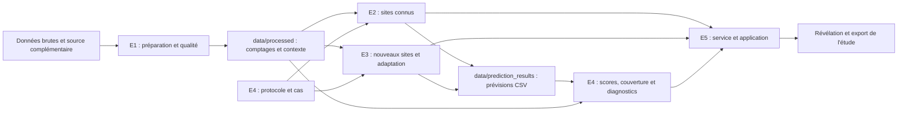

# Architecture de travail - ParisPulse

Ce dépôt contient une **structure à compléter par les cinq équipes** : fichiers de départ, consignes et formats d'échange. Les modules Python sont des gabarits documentés, sans algorithmes implémentés. Les modèles, l'application, les tests et le lancement restent à développer.

Références : [plan collectif](../PLAN_PROJET.md), [contrats](CONTRATS.md), [protocole proposé](PROTOCOLE_EVALUATION.md) et [sujet](../ParisPulse_Sujet_etudiants.pdf).

## 1. Organisation conservée dans ce dépôt

```text
config/
  project.example.yaml          paramètres à discuter puis copier dans project.yaml
src/
  common/
    contracts.py                E1–E5 : cas, entrées, sorties et validations
    config.py                   chemins relatifs et chargement des paramètres
  data/                         E1
    acquire.py                  extraction et provenance
    prepare.py                  normalisation, identifiants et grille horaire
    context.py                  source complémentaire et jointure contrôlée
    quality.py                  inventaire, manques, zéros et alertes
  models/
    registry.py                 E2/E3 : description et sélection des méthodes
    known/                      E2
      baseline.py               référence hebdomadaire et repli
      features.py               variables causales et calendrier
      train.py                  apprentissage, variantes et paramètres
      predict.py                prévisions de 24 heures et export CSV
    new/                        E3
      predict.py                méthode apprise ailleurs, support local borné
      adapt.py                  adaptation légère sur le même support
  eval/                         E4
    protocol.py                 sites, dates, cas et information autorisée
    metrics.py                  MAE, couverture et comparaisons équitables
    backtest.py                 orchestration des expériences et diagnostics
  app/                          E5
    service.py                  appels des composants E1–E4 et cache
    streamlit_app.py            carte, sélection, courbes et révélation
    export.py                   export de l'étude et de sa provenance
data/
  history/                      données brutes conservées
  processed/                    vérité terrain préparée et métadonnées E1
  manifests/                    provenance, licences, versions et empreintes
  prediction_results/           prévisions E2/E3, sans observations cibles
  evaluation/                   cas, scores, erreurs et couverture E4
artifacts/
  models/                       poids, paramètres et fiches modèles
  cache/                        résultats réutilisables et conditions de validité
  exports/                      études exportées par l'application
notebooks/                      exploration ; traitements partagés dans src/
tests/                          scénarios à implémenter et vérifications croisées
reports/
  teams/                        rapports par équipe
  individual/                   journaux individuels datés
  experiments/                  fiches des comparaisons
doc/
  templates/                    en-têtes CSV et fiches à copier/remplir
Dockerfile                      consignes de packaging, à compléter
requirements.txt                dépendances à choisir et à figer
run.sh.example                  contrat du futur lanceur, à compléter
```

`doc/` est le répertoire de documentation de ce dépôt. Les noms `src/data/`, `src/models/`, `src/eval/`, `src/app/` et `data/history/` sont conservés. Les échanges CSV existants restent la convention commune ; Parquet peut servir de format interne si une équipe en a besoin.

## 2. Flux de travail entre équipes



E4 fournit les cas avant les expériences, puis évalue les résultats. E5 appelle les calculs exécutables des partenaires ; les CSV servent à tracer les expériences et à les partager. La référence doit aussi être recalculable pour une autre date, sans se limiter à un fichier préenregistré.

## 3. Première chaîne à construire

1. **E1** extrait un compteur réel et transmet `counts.csv`, `counters.csv` et sa provenance.
2. **E4** propose une origine, les données admissibles et un `case_id` partagé.
3. **E2** calcule 24 valeurs de référence et un repli, puis fournit une fonction et un CSV conformes.
4. **E4** vérifie quelques valeurs à la main puis le score sur les heures réellement mesurées.
5. **E5** affiche le cas, la prévision et les observations révélées à la demande.
6. **Toutes** vérifient une seconde origine et un cas avec manque ; **E3** prépare en parallèle les sites réservés et une méthode transférable.

Objectif du sujet : une prévision et son score intégrés avant la fin de la première matinée si les accès fonctionnent. Le premier compteur technique ne justifie pas l'échantillon scientifique final.

## 4. Fichiers et formats partagés

Les [gabarits](templates/README.md) contiennent uniquement des en-têtes et des champs à renseigner. Ils ne sont pas des données d'étude ni des résultats.

| Producteur | Fichier de travail attendu | Consommateurs |
| --- | --- | --- |
| E1 | `data/processed/<snapshot_id>/counts.csv` | E2/E3/E4/E5 |
| E1 | `counters.csv`, `inventory_quality.csv`, `context.csv` dans le même instantané | E2/E3/E4/E5 |
| E1 | `data/manifests/<snapshot_id>.json` | Toutes |
| E4 | `data/evaluation/<protocol_id>/cases.csv` | E2/E3/E5 |
| E2/E3 | `data/prediction_results/<experiment_id>/<method_run_id>.pred.csv` | E4/E5 |
| E2/E3 | `<method_run_id>.runs.csv` dans le même dossier | E4/E5 |
| E4 | `data/evaluation/<protocol_id>/<experiment_id>/scores.csv`, `errors.csv`, `coverage.csv` | Toutes |
| E2/E3 | `artifacts/models/<model_run_id>/metadata.json` et poids éventuels | E4/E5 |
| E5 | `artifacts/exports/<study_id>.zip` | Utilisateur de l'application |

CSV UTF-8, séparateur virgule, point décimal, dates ISO 8601 avec fuseau UTC, booléens `true`/`false`, valeurs absentes laissées vides. Une liste telle que `quality_flags` est encodée en JSON dans sa cellule. Le zéro est une observation distincte du manque.

## 5. Interface à convenir avant de coder

Le fichier `src/common/contracts.py` décrit les objets à implémenter ensemble :

- **Cas** : compteur, origine, scénario connu/nouveau, budget local, instantané, protocole et identifiant stable indépendant du modèle.
- **Entrées autorisées** : historique filtré à l'origine et contexte réellement connu, sans cibles futures.
- **Sortie** : 24 horizons horodatés, méthode effective, statut, provenance et coût.

Chaque méthode E2/E3 devra accepter les mêmes entrées contrôlées et produire la même structure de sortie. Les signatures proposées dans les [contrats](CONTRATS.md) restent à adopter ensemble ; aucun service n'est encore implémenté.

À contrôler : `available_at <= origin`, coupure du modèle antérieure à l'origine, 24 intervalles UTC consécutifs, support local identique pour les variantes E3 et sites physiques réservés exclus de l'apprentissage. Le délai J−1 simulé et les séparations doivent être validés avec E4 et le professeur avant les comparaisons de sélection.

## 6. Travail attendu par équipe

| Équipe | Première livraison | Suite du travail |
| --- | --- | --- |
| E1 | Série réelle propre, localisation et alertes | Inventaire du réseau, contexte intégré, audit, extension et manifeste |
| E2 | Référence hebdomadaire, repli et recalcul sur une autre date | Modèle sites connus, ablation d'information, contribution DL, robustesse et coûts |
| E3 | Sites entiers réservés et prévision sur support limité | Méthode gelée vs adaptée, même historique, plusieurs sites et budgets |
| E4 | Petit score manuel, dates et cas proposés | Validation du protocole, MAE macro, cas complets, fiabilité et test final réservé |
| E5 | Carte et premier appel réel des partenaires | Deux situations, révélation, exports, cache, installation et packaging |

L'expérience de deep learning est obligatoire au niveau collectif. E2/E3 doivent attribuer explicitement sa responsabilité et conserver un résultat interprétable, même sans gain.

## 7. Lancement et packaging à réaliser

Le `Dockerfile`, `requirements.txt` et `run.sh.example` contiennent des instructions, pas une application prête à lancer. E5 doit choisir et figer l'environnement commun, préparer les ressources et fournir ensuite une commande unique documentée.

Critères de sortie : installation depuis une copie neuve par une autre équipe ; référence recalculée sur un autre cas ; redémarrage et nouvelle sélection ; ressources accessibles sans chemin personnel ; poids et paramètres annoncés fournis ; aucune dépendance obligatoire à un GPU pour les fonctions essentielles.

Les tests à développer sont décrits dans [tests/README.md](../tests/README.md). Les rapports et journaux utilisent les [fiches de suivi](templates/README.md). Les tests et expériences ne sont pas exécutés par ce squelette.
