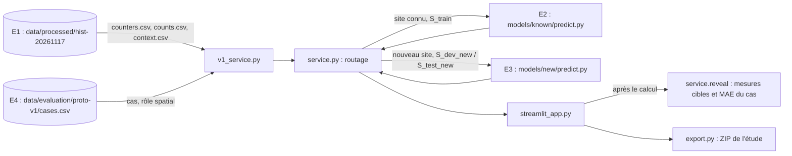

# ParisPulse V2 - Guide de l'application (E5)

L'application Streamlit prévoit les 24 prochaines heures d'un compteur vélo parisien, puis
compare la prévision aux mesures réelles. Elle appelle les calculs des autres équipes :
données E1, modèles E2 (sites connus) et E3 (nouveaux sites), cas E4.

## Lancer

Depuis la racine du dépôt :

```sh
./run.sh demo   # première fois : dépendances (dont PyTorch), instantané E1, lancement
./run.sh app    # fois suivantes
```

Sous Windows, après avoir extrait `livraison/hist-20261117.zip` à la racine :

```sh
uv sync --locked --group dl
uv run --locked --group dl python -m streamlit run src/app/streamlit_app.py
```

L'application s'ouvre sur <http://localhost:8501>. Le groupe `dl` (PyTorch) est obligatoire :
l'application l'importe au démarrage. Le premier calcul Chronos-2 télécharge les poids publics
`amazon/chronos-2` depuis Hugging Face (environ 2 minutes mesurées) ; les calculs suivants
prennent moins d'une seconde. Le fond de carte demande Internet ; la sélection par menu, les
prévisions et l'export fonctionnent avec les fichiers locaux.

## Parcours

1. **Choisir un compteur.** Cliquer sur la carte ou utiliser le menu **Compteur et sens**.
   Le filtre **Périmètre** propose *Tout le réseau* (par défaut), *Sites connus* ou
   *Nouveaux sites*. Le menu donne aussi accès aux compteurs sans coordonnées et distingue
   les deux sens d'un même lieu. Couleurs de la carte : turquoise = E2, bleu = E3,
   gris = inventaire seul.
2. **Choisir la date et la méthode.**
   - *Site connu* : une **Date de départ** (minuit à Paris). La date proposée est la fin de la
     validation, le 31 août 2026, pour ne pas toucher au test final réservé.
   - *Nouveau site* : un **Budget d'historique local** (24, 72 ou 168 heures), puis un départ
     parmi les cas E4 du protocole `proto-v1`, ou une date libre avec **Choisir une date libre**.
3. **Calculer la prévision.** Le bouton transmet le cas au moteur désigné par E4 et affiche
   le graphique, les indicateurs et le tableau des 24 heures (valeur, statut, méthode
   effective, raison d'un repli).
4. **Lire le résultat.** Les mesures réelles et l'erreur absolue moyenne (MAE) du cas
   s'affichent avec la prévision. Ce score porte sur un seul cas : c'est un contrôle, pas le
   score officiel E4.
5. **Exporter.** **Télécharger cases.csv** fournit la ligne du cas au format E4.
   **Télécharger l'étude (.zip)** fournit le cas, les prévisions, le manifeste et les coûts ;
   le ZIP contient aussi les observations et les erreurs lorsque la comparaison est calculée.

### Méthodes proposées

| Situation | Méthode | Ce qu'elle fait |
| --- | --- | --- |
| Site connu (`S_train`) | **HGB (modèle entraîné)**, par défaut | Gradient boosting d'E2 avec le contexte E1 (calendrier, grèves, météo prévue) |
| | Même heure la semaine précédente | Référence E2 : y(t − 168 h) |
| | Médiane des quatre semaines précédentes | Référence E2 : médiane de y(t − k × 168 h), k = 1 à 4 |
| | Comparer les deux références | Les deux références sur la même date, avec couverture, replis et durée |
| Nouveau site (`S_dev_new`, `S_test_new`) | Chronos-2 gelé | Modèle public préentraîné, sans adaptation, sur l'historique local autorisé |
| | Chronos-2 adapté v2 | Mélange de Chronos-2 et du profil horaire local (voir plus bas) |
| | Comparer Chronos-2 avant et après adaptation | Gelé et adapté v2 sur le même historique local |
| | Comparer la référence locale et Chronos-2 | Référence hebdomadaire limitée au budget local, et Chronos-2 gelé |
| | Référence locale E3 | Référence hebdomadaire calculée sur le seul historique local |
| | Prévisions archivées | Avec **Proposer les prévisions archivées** : lecture des fichiers d'E3 (`data/prediction_results/EXP-E3/`) |

### Replis

Le HGB refuse un cas qu'il ne sait pas traiter, par exemple une date antérieure au
1er juillet 2026 (fin de son apprentissage). La référence hebdomadaire d'E2 répond alors.
L'écran l'annonce (« Le HGB n'a pas prévu ce cas : … ») et chaque heure porte le statut
*Avec repli* et sa raison. Une référence se replie aussi heure par heure quand la mesure de la
semaine précédente manque.

### Onglets

| Onglet | Contenu |
| --- | --- |
| Prévision | Graphique, indicateurs (heures prédites, replis, MAE, temps de calcul), 24 lignes horaires |
| Historique disponible | Passé publié au moment de la prévision, seul autorisé en entrée |
| Données manquantes | Comptages, heures estimées par E1 et heures sans valeur ; fenêtre de 7, 30 ou 90 jours pour un site connu, historique local pour un nouveau site |
| Contexte E1 | Calendrier, grèves et météo connus au départ |

## Adaptation v2 de Chronos-2

Chronos-2 n'est **pas réentraîné**. Pour chaque heure cible, la prévision est mélangée avec la
médiane des mesures locales à la même heure (heure de Paris), calculée sur le seul historique
local autorisé :

```text
prévision = max(0, poids × Chronos-2 + (1 − poids) × profil local)
```

Si le profil manque pour une heure, la prévision de Chronos-2 est gardée. Les poids sont
**0,80** (budget 24 h), **0,80** (72 h) et **0,85** (168 h). E3 les a **choisis** une fois, par
une recherche sur une grille de 0 à 1 (pas de 0,05), sur les cas de validation des sites
`S_dev_new`. Ils sont enregistrés dans
[artifacts/models/e3-chronos2-adapted-v2/](../../artifacts/models/e3-chronos2-adapted-v2/).
Ces mêmes cas servent à évaluer l'adaptation : un gain mesuré sur ces sites est probablement
optimiste, et l'écran le rappelle. Source : [fiche E3](../../reports/experiments/E3-chronos-adapted-v2.md).

## Comment l'application appelle les autres équipes



- **E1** : `v1_service.load_inventory` lit l'inventaire, `load_counter_history` lit les comptages
  d'un seul compteur, `service.load_context` lit le contexte.
- **E4** : `src/eval/cases.py` fournit le cas (`interactive_case`, `case_csv`) et le moteur
  (`forecasting_team`) : **E4 → E2** pour un site connu, **E4 → E3** pour un nouveau site.
  Une date libre crée un cas `technique-e5`, sans modifier les fichiers d'E4.
- **E2 / E3** : `service.run_studies` filtre l'historique publié à l'origine
  (`published_history`, délai de publication de 24 h), appelle `predict_24h` d'E2 ou d'E3,
  puis contrôle les 24 lignes (`validate_forecast`).
- **Révélation** : `service.reveal` lit les mesures cibles séparément, après le calcul ; la
  prévision n'est jamais recalculée.

## Limites

- La MAE affichée porte sur un seul cas. Les scores officiels d'E4 (moyenne entre compteurs)
  ne sont pas affichés dans l'application.
- Le MLP d'E2 n'est pas proposé ; TimesFM et le MLP n'existent qu'en archives E3.
- Le HGB produit une prévision pour un compteur dont la dernière mesure est ancienne : le
  31/08/2026, il prévoit « 39 quai François Mauriac », sans mesure depuis le 5 juillet, sans
  avertissement.
- Sur les sites `S_test_new`, une partie des dates proposées tombe dans le test final réservé.
- Les modules `dashboard/comparison.py`, `errors.py`, `history.py`, `missing_data.py`,
  `predictions.py` et `counter_map.py` ne sont pas appelés par l'application.

L'ancienne version reste accessible avec
`uv run --locked python -m streamlit run src/app/v1_app.py`.
